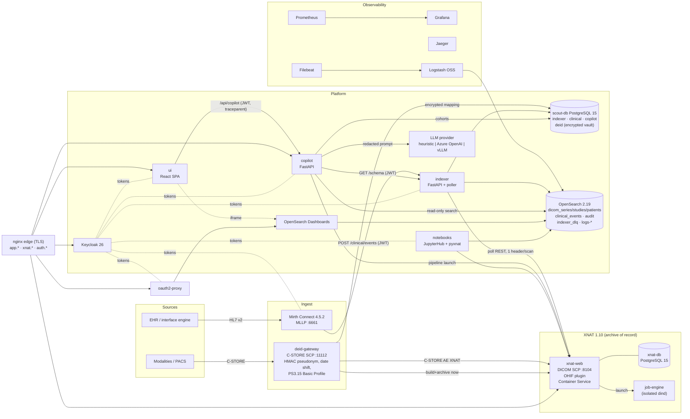
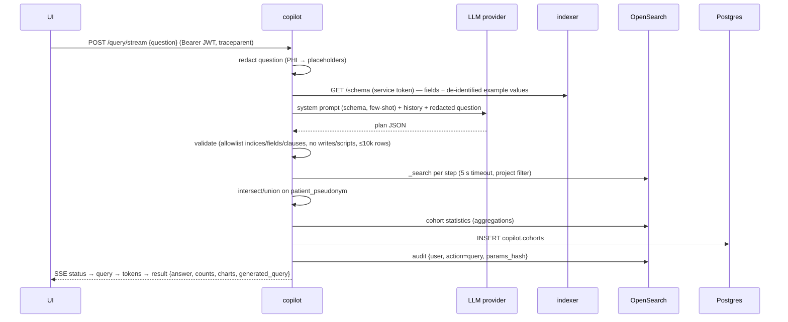

# ScoutOSS architecture

ScoutOSS turns an XNAT archive plus HL7 clinical feeds into a de-identified, searchable
research data lake with dashboards, a natural-language copilot, notebooks, an OHIF viewer
and containerized AI pipelines.

## Component diagram

## Data flows

### Imaging (C-STORE → searchable in seconds)

1. A modality sends to the **de-identification gateway** (AE `SCOUTGW`). The called AE
   selects the XNAT project (`GATEWAY_PROJECT_MAP`, default `SCOUT_DEMO`).
2. Each instance is de-identified in memory (`scoutoss_indexer.deid`): `PatientID`/`PatientName`
   become `SP<96-bit HMAC-SHA256>`; UIDs become deterministic `2.25.<HMAC>` UIDs; every DA/DT is
   shifted by the project's random offset (−730…−30 days); PS3.15 Basic Profile removals apply;
   descriptors are scrubbed; ages are derived before birth dates are blanked (capped at 90).
   SR/DOC/KO/PR and burned-in-annotation objects are rejected. The original ID is written to the
   AES-256-GCM vault (`deid.subject_map`).
3. On association release the gateway forwards to XNAT (`AE XNAT :8104`, whitelisted to `SCOUTGW`)
   and immediately asks XNAT to build and archive those sessions (the "expediter"), instead of
   waiting ≥ 1 minute for XNAT's session rebuilder. It also retries XNAT's first-boot build race.
4. The project DicomEdit script (`xnat/anon/scoutoss.das`) re-applies the removals as a second
   layer for anything that reaches the project another way.
5. The **indexer** polls `/data/experiments` every 5–10 s. A Postgres cursor (`indexer.xnat_cursor`)
   records each session's change token; new/changed sessions are fetched one DICOM header per scan
   (instance count from the file listing — pixel data is never bulk-copied), re-checked for
   de-identification, and bulk-indexed with deterministic IDs. Study and patient documents are
   *recomputed* from series documents, so reprocessing is idempotent. Failures go to `indexer_dlq`.

Measured on the dev stack: C-STORE → archived in XNAT ≈ 3–5 s → searchable ≈ 4–10 s.

### Clinical (HL7 v2)

Mirth's channel (`services/hl7-gateway`) parses ADT^A01/A08, ORM^O01 and ORU^R01 into a JSON
event, obtains a client-credentials token and posts to `/clinical/events`. The indexer
pseudonymizes PID-3 with the **same salt**, shifts dates with the project offset, scrubs free
text, categorizes ICD-10 codes (e.g. `C34.*` → `LUNG_CANCER`), writes `clinical.*` and
`clinical_events`, and folds diagnoses into `dicom_patients`. Mirth keeps metadata only.

### Copilot (question → answer)

The **query plan** (one or more read-only searches combined on `patient_pseudonym`) is the
join mechanism OpenSearch lacks, and it is exactly what the UI's *Review Code* panel shows.
Numbers in answers are computed, never generated. With `LLM_PROVIDER=heuristic` (default) a
deterministic rule-based planner speaks the same protocol, so no data leaves the host.

### Pipelines

`POST /cohorts/{id}/pipeline` resolves the cohort's studies to XNAT sessions (re-filtered by
the caller's projects) and launches a Container Service wrapper per session on the isolated
job engine. `scoutoss-qc` writes an `xnat:qcAssessmentData` assessor; `totalsegmentator`
writes a `TOTALSEG` NIfTI resource per CT scan.

## Security model

| Boundary | Mechanism |
|---|---|
| Users | Keycloak OIDC (PKCE for the SPA, oauth2-proxy for Dashboards/Jaeger/Prometheus, OAuth for JupyterHub, `openid-auth-plugin` for XNAT/OHIF) |
| Services | Keycloak client credentials (`copilot→indexer`, `mirth→indexer`), RS256 JWT with audience checks |
| Roles | `viewer` (query), `researcher` (+ save/export/launch), `admin` (+ reindex, all projects), `service` |
| Tenancy | Keycloak groups `/projects/<ID>` are the single source: every copilot search, stat, export and launch is filtered by them, and `xnat-access-sync` mirrors them into XNAT's read-only collaborator role for signed-on users |
| Data | Only pseudonymized, date-shifted, cleaned data enters XNAT and OpenSearch; the re-id vault is AES-GCM encrypted and readable only by role `deid_svc` |
| Network | Only nginx (443), the gateway (DICOM) and Mirth (MLLP) publish ports, on 127.0.0.1 in dev; XNAT's SCP accepts only AE `SCOUTGW`; Helm adds NetworkPolicies |

## Repository map

| Path | Contents |
|---|---|
| `services/common` | logging (structlog JSON + PHI scrubber), metrics, tracing, JWT auth, audit, PHI redaction, index catalog |
| `services/indexer` | de-identification, gateway, XNAT poller, indexer API, HL7 clinical ingest, synthetic data |
| `services/copilot` | LLM providers, redaction middleware, plan validator, executor, charts, cohorts, API |
| `services/ui` | React + Vite + TypeScript SPA |
| `services/hl7-gateway` | Mirth channel (transformer JS + generated export) |
| `services/notebooks` | JupyterHub image with pyxnat, example notebook |
| `services/pipelines/qc` | demo Container Service pipeline |
| `xnat/` | XNAT start script, DicomEdit script, Container Service commands, plugin jars (fetched) |
| `dashboards/` | OpenSearch Dashboards saved objects (generated by `scripts/gen_dashboards.py`) |
| `infra/` | nginx, Keycloak realm, Postgres init, Prometheus/alerts, Grafana, Jaeger, Filebeat, Logstash |
| `helm/scoutoss` | production chart |
| `tests/` | integration tests and shared test support (fake OpenSearch) |
| `scripts/` | bootstrap jobs, seed, e2e, health checks, generators |
