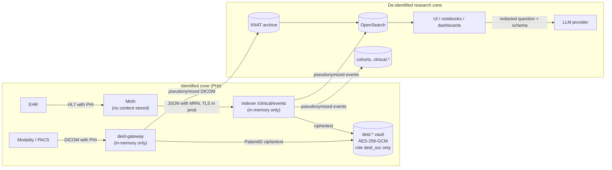

# ScoutOSS compliance notes (HIPAA / GDPR alignment)

ScoutOSS is designed so that the research platform only ever holds de-identified data and
every access is attributable. This document describes the controls; it is not legal advice,
and a deployment still needs its own risk assessment, BAAs/DPAs and an expert determination
where HIPAA Safe Harbor is not met.

## PHI data flow

PHI exists only in transit through the gateway and the clinical ingest, and as ciphertext in
the vault. Nothing downstream of those two components receives a direct identifier.

## De-identification specification

Implemented in `services/indexer/scoutoss_indexer/deid/` and covered by unit and integration
tests (`test_deidentify.py`, `test_dates_pseudonym.py`, `test_indexer_integration.py`).

| Element | Treatment |
|---|---|
| PatientID, PatientName | `SP` + first 96 bits of HMAC-SHA256(site salt, `patient:` + upper(ID)) |
| Study/Series/SOP/FrameOfReference and all other non-standard UIDs | `2.25.<int(HMAC-SHA256(salt, uid)[:16])>` — deterministic, consistent across references |
| All DA/DT values | shifted by one per-project offset in [−730, −30] days (encrypted in `deid.project_offset`); order and intervals preserved; unparseable dates are blanked |
| PatientBirthDate | age computed first (`PatientAge`), then emptied |
| PatientAge | kept; ages ≥ 90 reported as `090Y` / 90.0 (Safe Harbor) |
| PS3.15 Basic Profile attributes | removed (X), emptied (Z) or replaced (D) per `deid/profile.py` (~150 attributes incl. addresses, phone numbers, physician/operator names, accession, station, device serial, institution address, comments) |
| Descriptions (study/series/protocol/image comments) | kept, scrubbed by the shared PHI redactor (Clean Descriptors option) |
| InstitutionName | replaced by a coarse site code `SITE-xxxxxx` |
| Private tags, overlays (60xx), curves (50xx) | removed |
| Any other PN | emptied |
| SR, DOC, KO, PR, EncapsulatedDocument, BurnedInAnnotation=YES | rejected (not forwarded; counted and logged without content) |
| Markers written | PatientIdentityRemoved=YES, DeidentificationMethod, DeidentificationMethodCodeSequence (113100, 113107, 113108, 113105), LongitudinalTemporalInformationModified=MODIFIED |

Second layer: the XNAT project DicomEdit script repeats the removals for data that arrives by
other routes; XNAT's SCP only accepts the gateway's AE title. Third layer: the indexer refuses
to index a header that was not de-identified by ScoutOSS and de-identifies it itself.

**Pixel data**: burned-in text is not scrubbed; objects flagged `BurnedInAnnotation=YES` are
rejected and ultrasound/secondary-capture sources must be reviewed before onboarding.

HL7: PID-3 is pseudonymized with the same salt (so imaging and clinical data join), event
dates are shifted with the project offset, ages are capped, free text (diagnosis/order/lab
names, text results) is scrubbed; addresses, phone numbers and names are never extracted.

## Logging and LLM controls

* Every log record passes `scrub_phi` (`services/common/scoutoss_common/logging.py`): keys
  such as `patient_name`, `mrn`, `dataset`, `hl7` are replaced by `[REDACTED]`; values are
  scanned for SSNs, MRNs, phone numbers, e-mail, dates, DICOM person names and long digit runs.
  Services log UIDs, counts and pseudonyms only. Tested in `test_logging.py`.
* The copilot sends the LLM only field names, field descriptions, de-identified example
  values and the redacted question. `RedactingLLM` redacts every outbound message and blocks
  the call if anything PHI-shaped remains (`test_llm_redaction.py`). The LLM never receives
  documents, pixel data or result rows; answers are computed from aggregates.
* Default provider `heuristic` keeps all processing on-premises. Using Azure OpenAI requires a
  BAA/DPA, a region pinned to the data's jurisdiction and abuse monitoring opt-out.

## Audit model

`audit` index, written by the copilot and indexer with `op_type=create` and random IDs:

| Field | Meaning |
|---|---|
| `user` | `u_` + SHA-256(Keycloak `sub`)[:16] (pseudonymous, resolvable via Keycloak) |
| `action` | `query`, `cohort_save`, `cohort_read`, `export`, `pipeline_launch`, `reindex`, `clinical_ingest` |
| `resource` | cohort id / index / project |
| `params_hash` | SHA-256 of the canonical request parameters (no raw text) |
| `ts`, `ip`, `service`, `trace_id`, `outcome` | when/where/which trace; `success`, `rejected`, `phi_blocked` |

Calls fail closed (HTTP 503) if the audit write fails. Production: the services' OpenSearch
role has `create_doc` but not `index`/`delete` on `audit`; ISM `audit-retention` keeps it
6 years; snapshots are immutable (object lock). Keycloak login/admin events are retained by
the IdP; XNAT keeps its own access logs.

## Control mapping

| Requirement | HIPAA Security Rule | GDPR | ScoutOSS control |
|---|---|---|---|
| Access control, unique user IDs | 164.312(a)(1), (a)(2)(i) | Art. 32(1)(b) | Keycloak OIDC; RS256 JWT with audience checks on every API; roles viewer/researcher/admin; XNAT/OHIF use the same Keycloak identity (one account per person, read-only project access) |
| Minimum necessary / tenancy | 164.502(b), 164.514(d) | Art. 5(1)(c), 25 | project groups filter every query/export/launch; XNAT project RBAC; Dashboards DLS by project (prod) |
| Audit controls | 164.312(b) | Art. 30, 5(2) | append-only `audit` index, 6-year retention, request logs with user pseudonym and trace id |
| Integrity | 164.312(c)(1) | Art. 32(1)(b) | deterministic idempotent indexing; vault ciphertexts bound to their row (GCM AAD); pinned image versions |
| Person/entity authentication | 164.312(d) | Art. 32 | Keycloak (MFA policy configurable), brute-force protection, password policy |
| Transmission security | 164.312(e)(1) | Art. 32(1)(a) | TLS at the edge (cert-manager in prod), HSTS; in-cluster mTLS via service mesh recommended |
| Encryption at rest | 164.312(a)(2)(iv) | Art. 32(1)(a) | vault AES-256-GCM; Mirth content encryption; volume encryption at the platform layer |
| De-identification | 164.514(a)–(b) | Art. 4(5), Recital 26 (pseudonymization) | PS3.15 Basic + options; HMAC pseudonyms; date shifting; age capping; site codes |
| Data minimization in AI | — | Art. 5(1)(c), 25 | schema-only prompts, redaction middleware with leak guard, on-prem default planner |
| Retention | 164.316(b)(2) | Art. 5(1)(e) | ISM: logs 30 days, audit 6 years; cohorts deletable per user |
| Contingency plan / backup | 164.308(a)(7) | Art. 32(1)(c) | runbook backup/restore, RPO/RTO, quarterly restore test |
| Security management / vulnerabilities | 164.308(a)(1) | Art. 32(1)(d) | CI: Trivy image + config scans, pinned images, non-root containers, mypy/ruff gates |
| Re-identification | 164.514(c) | Art. 11 | only via the vault (role `deid_svc` + key escrow), outside the research zone; honest-broker procedure |

## Container hardening exceptions (dev compose)

* `job-engine` (Docker-in-Docker) is privileged so XNAT never receives the host Docker socket;
  production uses the Container Service Kubernetes backend instead.
* `filebeat` runs as root to read container log files (read-only mounts, no ports).
* `xnat-web` runs as uid 1000 (official image), `mirth` as its image user, nginx as 101;
  all ScoutOSS images run as uid 10001 with read-only root filesystems.
